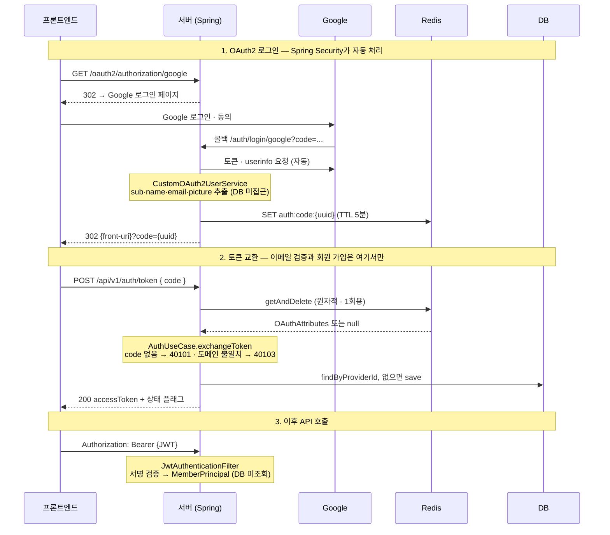

# 로그인 구현 가이드 (gudogging-BE 이식용)

> 작성일: 2026-10-24 · 원본 스펙: `.claude/features/auth/001_google_oauth2_login.yaml`

## 1. 개요

로그인은 **Google OAuth2(Authorization Code Flow) + Redis 일회용 코드 교환 + Stateless JWT Access Token** 구조다. 브라우저 URL에 JWT를 노출하지 않도록, OAuth2 성공 시에는 5분짜리 일회용 code만 프론트에 넘기고 프론트가 이를 `POST /api/v1/auth/token`으로 JWT와 교환한다.

핵심 설계 원칙:

- **OAuth2 단계에서는 DB를 건드리지 않는다.** Google 사용자 정보만 추출해 Redis에 임시 저장한다.
- **회원 가입·이메일 검증은 토큰 교환 단계에서 한다.** 허용되지 않은 이메일은 JSON 에러(40103)로 거절되고 User가 생성되지 않는다.
- **code는 1회용이다.** Redisson `getAndDelete()`로 조회와 삭제를 원자적으로 처리한다.
- **서버는 세션을 갖지 않는다.** 모든 API 요청은 `Authorization: Bearer <JWT>` 헤더로 인증하고, WebSocket은 별도 단기 토큰(ws-token)을 쓴다.

기준 구현: Spring Boot 4.0.5 / Java 21 / jjwt 0.13.0 / Redisson 4.1.0

## 2. 기술 스택 & 의존성

| 구분 | 의존성 | 버전 | 용도 |
| --- | --- | --- | --- |
| 런타임 | Java / Spring Boot | 21 / 4.0.5 | 기반 |
| 보안 | `spring-boot-starter-security` | Boot 관리 | 필터 체인, 인가 |
| 보안 | `spring-boot-starter-oauth2-client` | Boot 관리 | Google 로그인 리다이렉트/콜백 자동 처리 |
| JWT | `jjwt-api` (implementation), `jjwt-impl`·`jjwt-jackson` (runtimeOnly) | 0.13.0 | HMAC JWT 발급/검증 |
| 저장소 | `org.redisson:redisson` | 4.1.0 | 일회용 auth code, ws-token |
| 검증 | `spring-boot-starter-validation` | Boot 관리 | `@NotBlank` 요청 검증 |
| WebSocket(선택) | `spring-boot-starter-websocket` | Boot 관리 | ws-token 핸드셰이크 인증 |
| 문서(선택) | `springdoc-openapi-starter-webmvc-ui` | 3.0.2 | Swagger |
| 편의 | Lombok | Boot 관리 | `@RequiredArgsConstructor` 등 |
| 테스트 | `spring-boot-starter-security-test`, H2 | Boot 관리 | 보안 테스트 |

```groovy
implementation 'org.springframework.boot:spring-boot-starter-security'
implementation 'org.springframework.boot:spring-boot-starter-oauth2-client'
implementation 'org.springframework.boot:spring-boot-starter-validation'
implementation 'io.jsonwebtoken:jjwt-api:0.13.0'
runtimeOnly 'io.jsonwebtoken:jjwt-impl:0.13.0'
runtimeOnly 'io.jsonwebtoken:jjwt-jackson:0.13.0'
implementation 'org.redisson:redisson:4.1.0'
```

외부 준비물: Google Cloud Console의 OAuth 2.0 클라이언트(웹 애플리케이션), Redis 서버, 프론트엔드 콜백 URL.

## 3. 인증 흐름

서버가 프론트로 넘기는 것은 5분짜리 일회용 code뿐이고, 이메일 검증·회원 가입·JWT 발급은 모두 토큰 교환 API 한 곳에서 일어난다.



1단계는 Redis에만 쓰고 DB는 건드리지 않는다. `302 {front-uri}?code={uuid}` 리다이렉트가 브라우저 URL에 노출되는 유일한 값이다.

실패 경로:

- OAuth2 자체 실패(동의 거부 등) → `CustomOAuth2FailureHandler` → `{front-uri}/login?error={errorCode | oauth2_failed}`
- code 만료·재사용·없음 → 401 / 40101
- 허용 도메인이 아닌 이메일 → 401 / 40103, User 미생성
- JWT 만료·위조·누락 → `JwtAuthenticationEntryPoint` → 401 (`TOKEN_EXPIRED` 등)

## 4. 패키지 구조 & 주요 클래스

인증 코드는 `domain/auth`(토큰 교환 유스케이스)와 `global`(Security·OAuth2·JWT·Redis 인프라) 두 곳에 나뉘어 있다. 회원 조회/생성은 `domain/user`의 도메인 서비스에 위임한다.

```text
com.project.{app}
├─ domain/auth
│  ├─ presentation/AuthController                 # POST /api/v1/auth/token, /ws-token
│  ├─ presentation/response/AuthResponseCode      # 성공 응답 코드 enum
│  ├─ application/usecase/AuthUseCase             # code 소비 → 이메일 검증 → 가입/조회 → JWT
│  ├─ application/dto/request/TokenExchangeRequest
│  ├─ application/dto/response/TokenExchangeResponse, WsTokenResponse
│  └─ application/exception/AuthErrorCode + 예외 3종
├─ domain/user
│  ├─ domain/entity/User                          # providerId로 식별
│  ├─ domain/repository/UserRepository            # findByProviderIdAndDeletedFalse
│  └─ domain/service/UserGetService, UserCreateService
└─ global
   ├─ config/security/SecurityConfig              # 필터 체인 + CORS
   ├─ config/security/PermitUrlConfig             # 인증 제외 URL 목록
   ├─ config/security/JwtAuthenticationEntryPoint # 401 JSON 응답
   ├─ config/security/oauth2/
   │  ├─ CustomOAuth2UserService                  # Google attributes → Principal (DB 접근 없음)
   │  ├─ OAuth2UserPrincipal                      # OAuth2User 구현체
   │  ├─ OAuthAttributes                          # Redis에 저장할 record
   │  ├─ CustomOAuth2SuccessHandler               # Redis code 발급 → 프론트 리다이렉트
   │  └─ CustomOAuth2FailureHandler               # {front}/login?error=...
   ├─ config/websocket/WsAuthHandshakeInterceptor # ?token= 검증
   ├─ config/web/WebMvcConfig                     # ArgumentResolver 등록
   ├─ annotation/CurrentMemberId (+ Resolver)     # 컨트롤러에서 memberId 주입
   ├─ jwt/JwtProvider                             # 발급
   ├─ jwt/JwtAuthenticator                        # 파싱/검증
   ├─ jwt/JwtAuthenticationFilter                 # Bearer 헤더 → SecurityContext
   ├─ jwt/Role, jwt/principal/MemberPrincipal
   ├─ infrastructure/redis/RedisConfig, RedisService
   └─ dev/DevController, DevUseCase               # local/dev 전용 테스트 토큰
```

| 클래스 | 책임 | 이식 시 포인트 |
| --- | --- | --- |
| `CustomOAuth2UserService` | `DefaultOAuth2UserService.loadUser()` 후 `sub`, `name`, `email`, `picture`를 뽑아 `OAuth2UserPrincipal` 생성 | 테스트를 위해 추출 로직을 package-private `processOAuth2User(Map)`로 분리. 카카오/네이버는 attribute 키가 다르므로 여기를 수정 |
| `CustomOAuth2SuccessHandler` | Principal → `OAuthAttributes` → `redisService.createAuthorizationCode()` → `{front-uri}?code={uuid}` | JWT를 URL에 싣지 않는 것이 핵심 |
| `CustomOAuth2FailureHandler` | `OAuth2AuthenticationException`이면 그 errorCode로, 아니면 `oauth2_failed`로 `{front-uri}/login?error=` 리다이렉트 | 프론트 로그인 페이지 경로에 맞추기 |
| `AuthUseCase.exchangeToken` | code 원자적 소비 → 이메일 도메인 검사 → `providerId`로 조회, 없으면 `User.create()` 저장 → JWT 발급 | `@Transactional`(write). 도메인 제한이 필요 없으면 `ALLOWED_EMAIL_DOMAIN` 검사만 제거 |
| `JwtAuthenticationFilter` | `Authorization: Bearer` 파싱 → 클레임으로 `MemberPrincipal` 구성(DB 조회 없음). 실패 시 `request.setAttribute("exception", e)` | `@Component`가 아니라 `new`로 등록 — 서블릿 필터 자동 등록(이중 실행) 방지 |
| `JwtAuthenticationEntryPoint` | 필터가 남긴 예외 타입을 보고 401 JSON(`code`, `message`) 작성 | 인증 없이 보호 API 접근 시에도 여기로 온다 |
| `CurrentMemberIdArgumentResolver` | `@CurrentMemberId Long memberId` 파라미터에 SecurityContext의 memberId 주입. `required=false`면 비로그인 시 null | `WebMvcConfig`에 등록 필수. `@Parameter(hidden = true)`로 Swagger에서 숨김 |
| `RedisService` | auth code / ws-token의 발급·소비. `RBucket.getAndDelete()` 사용 | `ObjectMapper`로 JSON 직렬화 |

## 5. 토큰 설계

토큰은 세 종류다. 현재 구현에는 **Refresh Token과 로그아웃 API가 없다.** Access Token 만료(3일) 시 프론트가 다시 Google 로그인을 태우고, 로그아웃은 클라이언트가 토큰을 버리는 방식이다.

| 토큰 | 형식 | 저장 위치 | TTL | 사용처 | 소비 방식 |
| --- | --- | --- | --- | --- | --- |
| Authorization Code | UUID | Redis `auth:code:{uuid}` → `OAuthAttributes` JSON | 5분 | OAuth2 성공 → 토큰 교환 | 1회용 (`getAndDelete`) |
| Access Token | JWT (HMAC) | 클라이언트 | `jwt.access.expiration-seconds` = 259200초(3일) | 모든 보호 API (`Authorization: Bearer`) | 만료 전까지 재사용 |
| WS Token | UUID | Redis `ws:token:{uuid}` → `"{userId}:{memberName}"` | 코드상 12시간 (아래 참고) | WebSocket 핸드셰이크 `?token=` | 1회용 (`getAndDelete`) |

### JWT 클레임

| 클레임 | 값 | 비고 |
| --- | --- | --- |
| `sub` | userId (Long → String) | 필터에서 `Long.parseLong` |
| `name` | username | |
| `role` | `MEMBER` | `Role` enum. 권한은 `ROLE_MEMBER` |
| `iat` | 발급 시각 | |
| `exp` | `iat + expirationSeconds` | |

### 발급과 검증

발급(`JwtProvider`)과 검증(`JwtAuthenticator`)을 별도 빈으로 두고, 둘 다 `jwt.access.secret`을 Base64 디코딩해 `Keys.hmacShaKeyFor()`로 SecretKey를 만든다. 시크릿은 디코딩 후 최소 256bit(32바이트)여야 하며, 알고리즘은 키 길이에 따라 jjwt가 HS256/384/512 중 자동 선택한다.

```java
// JwtProvider
return Jwts.builder()
        .subject(String.valueOf(memberId))
        .claim("name", memberName)
        .claim("role", Role.MEMBER.name())
        .issuedAt(now)
        .expiration(new Date(now.getTime() + expirationSeconds * 1000L))
        .signWith(accessKey)
        .compact();

// JwtAuthenticator
return Jwts.parser().verifyWith(accessKey).build()
        .parseSignedClaims(token).getPayload();
```

필터는 클레임만으로 `MemberPrincipal(memberId, memberName, role)`을 만들고 DB를 조회하지 않는다. 따라서 탈퇴한 회원의 토큰도 만료 전까지는 필터를 통과한다. 각 유스케이스의 `UserGetService.getById()`(deleted=false 조건)가 실질적인 방어선이다.

### 코드와 문서가 어긋난 부분

- WS Token TTL: 스펙은 1분, Swagger 설명은 30초, 코드는 `Duration.ofHours(12)`다. 커밋 `b0bbd38`("토큰 유효기간 임시로 길게 변경")에서 5분→12시간으로 임시 조정된 값이다. 새 프로젝트에서는 30초~5분 사이로 잡는 것을 권장한다.
- Access Token은 3일로 길고 강제 만료 수단이 없다. 새 프로젝트에 보안 요구가 있다면 Refresh Token(Redis 저장) + 짧은 Access Token 도입을 별도 검토해야 한다.

## 6. Security 설정

`SecurityConfig` 하나가 무상태(STATELESS) API + OAuth2 로그인 + JWT 필터를 모두 엮는다. 그대로 복사해 항목만 바꾸면 된다.

```java
@Bean
public SecurityFilterChain filterChain(HttpSecurity http) {
    http
        .csrf(AbstractHttpConfigurer::disable)
        .cors(cors -> cors.configurationSource(corsConfigurationSource()))
        .formLogin(AbstractHttpConfigurer::disable)
        .httpBasic(AbstractHttpConfigurer::disable)
        .sessionManagement(s -> s.sessionCreationPolicy(SessionCreationPolicy.STATELESS))
        .exceptionHandling(ex -> ex.authenticationEntryPoint(jwtAuthenticationEntryPoint))
        .oauth2Login(oauth2 -> oauth2
            .redirectionEndpoint(e -> e.baseUri("/auth/login/*"))   // 콜백 경로 커스텀
            .userInfoEndpoint(u -> u.userService(customOAuth2UserService))
            .successHandler(customOAuth2SuccessHandler)
            .failureHandler(customOAuth2FailureHandler))
        .authorizeHttpRequests(auth -> auth
            .requestMatchers(HttpMethod.OPTIONS, "/**").permitAll()
            .requestMatchers(permitUrlConfig.publicUrls()).permitAll()
            .anyRequest().authenticated())
        .addFilterBefore(new JwtAuthenticationFilter(jwtAuthenticator),
                         UsernamePasswordAuthenticationFilter.class);
    return http.build();
}
```

| 항목 | 설정 | 이유 |
| --- | --- | --- |
| 콜백 경로 | `/auth/login/*` (기본값 `/login/oauth2/code/*` 대신) | yml의 `redirect-uri`, Google Console의 승인된 리디렉션 URI와 **세 곳이 일치**해야 한다 |
| 세션 | `STATELESS` | SecurityContext는 매 요청 JWT로 복원 |
| CSRF / formLogin / httpBasic | 비활성화 | 쿠키 세션을 쓰지 않는 Bearer 방식 |
| 인증 제외 URL | `PermitUrlConfig.publicUrls()` | 아래 목록 |
| 인증 실패 응답 | `JwtAuthenticationEntryPoint` | 401 + `{"code","message"}` JSON |
| CORS | 허용 origin 목록 직접 지정, 메서드 GET/POST/PUT/PATCH/DELETE/OPTIONS, 헤더 `*`, `Authorization` 노출 | 프론트 로컬(3000, 5173) + 배포 도메인 |

인증 제외 URL (`PermitUrlConfig`):

- `/oauth2/authorization/**` — 로그인 시작
- `/auth/login/**` — OAuth2 콜백
- `/api/v1/auth/token` — code → JWT 교환
- `/api/v1/dev/**` — 개발용 토큰 (컨트롤러는 `@Profile({"local","dev"})`)
- `/v3/api-docs/**`, `/swagger-ui/**`, `/swagger-resources/**`
- `/ws/chat/**` — WebSocket은 핸드셰이크 인터셉터가 자체 인증
- `/actuator/health`, `/actuator/health/**`

### 인증 실패 처리 방식

필터는 예외를 던지지 않는다. 파싱 실패 시 `request.setAttribute("exception", e)`로 남기고 SecurityContext를 비운 뒤 체인을 계속 태운다. 보호 URL이면 인가 단계에서 EntryPoint가 호출되고, 저장된 예외 타입으로 에러 코드를 고른다. 공개 URL은 잘못된 토큰이 있어도 그냥 통과한다.

| 예외 (jjwt) | code | message |
| --- | --- | --- |
| `ExpiredJwtException` | `TOKEN_EXPIRED` | 액세스 토큰이 만료되었습니다. |
| `MalformedJwtException` | `INVALID_TOKEN` | 유효하지 않은 토큰 형식입니다. |
| `SignatureException` | `INVALID_SIGNATURE` | 토큰 서명이 유효하지 않습니다. |
| 그 외 / 토큰 없음 | `UNAUTHORIZED` | 인증이 필요합니다. |

EntryPoint의 응답은 `CommonResponse` 포맷이 아닌 `{code: String, message}` 형태다. 새 프로젝트에서는 두 포맷을 하나로 맞출지 미리 정하는 것이 좋다.

### WebSocket 인증

브라우저 WebSocket은 헤더를 붙일 수 없어서 JWT 대신 ws-token을 쓴다. 클라이언트는 JWT로 `POST /api/v1/auth/ws-token`을 호출해 토큰을 받고, `ws://.../ws/chat?token={wsToken}`으로 연결한다. `WsAuthHandshakeInterceptor`가 `AuthUseCase.authenticateWsToken()`으로 검증하고, 성공하면 `attributes.put("principal", MemberPrincipal)`, 실패하면 401로 핸드셰이크를 거절한다. `WebSocketConfig.setAllowedOriginPatterns()`에도 CORS와 같은 origin을 넣어야 한다(최근 핫픽스 `45e9c69`의 원인).

## 7. API 명세

직접 만드는 컨트롤러 API는 2개(+개발용 1개)다. OAuth2 시작·콜백은 Spring Security가 처리하므로 컨트롤러가 필요 없다.

| Method | Path | 인증 | 요청 | 응답 |
| --- | --- | --- | --- | --- |
| GET | `/oauth2/authorization/google` | 공개 | — | 302 → Google 로그인 |
| GET | `/auth/login/google` | 공개 (Google이 호출) | `code`, `state` | 302 → `{front-uri}?code={uuid}` 또는 `{front-uri}/login?error=...` |
| POST | `/api/v1/auth/token` | 공개 | `{ "code": "uuid" }` (`@NotBlank`) | 200, `TokenExchangeResponse` |
| POST | `/api/v1/auth/ws-token` | JWT | — (`@AuthenticationPrincipal MemberPrincipal`) | 201, `{ "wsToken": "uuid" }` |
| POST | `/api/v1/dev/token/user` | `X-Dev-Secret` 헤더 | `{ "userId": 1 }` | 200, `{accessToken, userId, username}` (local/dev 프로필 전용) |

토큰 교환 성공 응답 예시 (`CommonResponse` 래퍼):

```json
{
  "code": 200,
  "message": "토큰이 발급되었습니다.",
  "data": {
    "accessToken": "eyJhbGciOi...",
    "userId": 1,
    "username": "홍길동",
    "isOnboarded": false,
    "isChecklistRegistered": false,
    "isRoommatePreferenceRegistered": false
  }
}
```

`isOnboarded` 등 플래그는 프론트가 로그인 직후 어느 페이지로 보낼지 결정하는 용도다. 새 프로젝트에서는 그 서비스의 온보딩 단계에 맞는 플래그로 바꾸면 된다.

### 에러 코드

Auth 도메인은 `401xx` 대역을 쓴다. `AuthErrorCode`가 `ErrorCodeInterface`를 구현하고, 각 예외는 `ApplicationException`을 상속해 `GlobalExceptionHandler`가 `CommonResponse.error()`로 변환한다.

| HTTP | code | 이름 | 메시지 | 발생 조건 |
| --- | --- | --- | --- | --- |
| 401 | 40101 | `INVALID_AUTHORIZATION_CODE` | 유효하지 않거나 만료된 인증 코드입니다. | Redis에 code 없음 (만료/재사용) |
| 401 | 40102 | `INVALID_WS_TOKEN` | 유효하지 않거나 만료된 WebSocket 토큰입니다. | ws-token 없음/형식 오류 |
| 401 | 40103 | `UNAUTHORIZED_EMAIL_DOMAIN` | 가천대학교 이메일(@gachon.ac.kr)로만 로그인 가능합니다. | 이메일이 null이거나 허용 도메인이 아님 |
| 400 | 40001 | `INVALID_ARGUMENT` | 잘못된 인자입니다. | `code`가 blank |
| 401 | 40005 | `UNAUTHORIZED` | 인증되지 않았습니다. | `@CurrentMemberId` 해석 실패, dev secret 불일치 |

## 8. 데이터 모델

로그인에 필요한 DB 테이블은 `users` 하나다. 토큰은 DB에 저장하지 않는다(code·ws-token은 Redis, JWT는 클라이언트).

| 컬럼 | 타입 / 제약 | 출처 | 비고 |
| --- | --- | --- | --- |
| `id` | BIGINT PK, IDENTITY | `BaseEntity` | JWT `sub` |
| `provider_id` | VARCHAR(255), NOT NULL, **UNIQUE** | Google `sub` | 회원 식별 키. 재로그인 시 이 값으로 조회 |
| `username` | VARCHAR(50), NOT NULL | Google `name` | JWT `name` 클레임 |
| `email` | VARCHAR(255), NOT NULL, UNIQUE | Google `email` | 도메인 검증 대상 |
| `profile_image` | VARCHAR(512), NULL | Google `picture` | |
| `is_onboarded` 등 상태 플래그 | BOOLEAN, NOT NULL, default false | 서비스 | 토큰 교환 응답에 포함 |
| 서비스 프로필 필드 (gender, birthYear 등) | NULL 허용 | 온보딩 | Google 기본 scope가 제공하지 않아 가입 시 null |
| `created_at`, `updated_at` | DATETIME, NOT NULL | `BaseEntity` | `@PrePersist` / `@PreUpdate` |
| `deleted`, `deleted_at` | BOOLEAN NOT NULL / DATETIME | `BaseEntity` | Soft delete. 조회는 항상 `...AndDeletedFalse` |

```java
// 가입 시점 팩토리: OAuth가 주는 값만 채우고 나머지는 null/false
public static User create(String providerId, String username, String email, String profileImage)

// UserRepository
Optional<User> findByProviderIdAndDeletedFalse(String providerId);
Optional<User> findByIdAndDeletedFalse(Long id);
```

여러 소셜(Google + 카카오 등)을 지원하려면 `provider`(GOOGLE/KAKAO) 컬럼을 추가하고 `(provider, provider_id)` 복합 UNIQUE로 바꿔야 한다. 현재 구현은 Google 단일 제공자를 전제로 `provider_id` 단독 UNIQUE다.

같은 사용자가 동시에 두 번 교환하면 조회 → 없음 → 저장이 경합할 수 있다. code가 1회용이라 실제로는 드물고, 발생해도 UNIQUE 제약 위반 → `DataIntegrityViolationException` → 500(30003)으로 끝난다.

## 9. 설정값 & 환경변수

프로필별 yml(`application-local.yaml`, `application-dev.yaml`)에 아래 키가 필요하다. 실제 시크릿 값은 이 문서에 옮기지 않았다.

```yaml
spring:
  security:
    oauth2:
      client:
        registration:
          google:
            client-id: ${GOOGLE_CLIENT_ID}
            client-secret: ${GOOGLE_CLIENT_SECRET}
            redirect-uri: http://localhost:8080/auth/login/google   # dev: ${GOOGLE_REDIRECT_URI}
            authorization-grant-type: authorization_code
            scope:
              - profile
              - email
  data:
    redis:
      host: localhost          # dev: ${REDIS_HOST}
      port: 6379

server-uri: http://localhost:8080
front-uri: http://localhost:5173   # OAuth2 성공/실패 리다이렉트 대상

jwt:
  access:
    secret: ${JWT_ACCESS_SECRET}     # Base64 인코딩, 디코딩 후 32바이트 이상
    expiration-seconds: 259200       # 3일

dev:
  secret: ${DEV_SECRET}              # /api/v1/dev/** 헤더 검증용
```

| 키 | 사용처 | 주의 |
| --- | --- | --- |
| `registration.google.redirect-uri` | Spring OAuth2 Client | `SecurityConfig`의 `/auth/login/*`, Google Console 승인 URI와 일치 |
| `front-uri` | Success/Failure Handler | 프론트 콜백 페이지가 `?code=`를 읽을 수 있어야 함 |
| `jwt.access.secret` | `JwtProvider`, `JwtAuthenticator` | 두 빈이 같은 키를 읽음. 생성 예: `openssl rand -base64 64` |
| `jwt.access.expiration-seconds` | `JwtProvider` | 초 단위 |
| `spring.data.redis.host/port` | `RedisConfig` (Redisson single server) | Spring Data Redis 자동설정이 아닌 Redisson 빈을 직접 생성 |
| `dev.secret` | `DevController` | local/dev 프로필에만 존재 |

Google Cloud Console 설정: OAuth 동의 화면에서 `email`, `profile` scope를 추가하고, 웹 클라이언트의 "승인된 리디렉션 URI"에 환경별 `{server-uri}/auth/login/google`을 모두 등록한다.

## 10. 테스트 전략

현재 테스트는 JUnit 5 + Mockito + AssertJ 단위 테스트 2개 클래스(총 13개 케이스)다. 외부 의존(Redis, Google, JWT)을 모두 mock으로 대체해 유스케이스 분기만 검증한다. `@Nested` + `@DisplayName`(한글 문장) + 한글 메서드명, `// given / when / then` 구조를 쓴다.

| 테스트 클래스 | 대상 | 케이스 |
| --- | --- | --- |
| `AuthUseCaseTest` | `AuthUseCase.exchangeToken` | 기존 회원 조회(생성 안 함 `verify(never())`), 신규 회원 자동 가입, 상태 플래그 조합 5종, 만료/없는 code → 40101, 재사용 code → 40101, 비허용 이메일(gmail, 타 대학 .ac.kr) → 40103 + User 미생성 |
| `CustomOAuth2UserServiceTest` | `processOAuth2User(Map)` | attributes → Principal 매핑, 비허용 이메일도 OAuth2 단계에서는 통과 |

```java
@ExtendWith(MockitoExtension.class)
class AuthUseCaseTest {
    @Mock RedisService redisService;
    @Mock UserGetService userGetService;
    @Mock UserCreateService userCreateService;
    @Mock JwtProvider jwtProvider;
    @InjectMocks AuthUseCase authUseCase;

    @Test
    @DisplayName("허용되지 않은 이메일이면 예외가 발생하고 User는 생성되지 않는다")
    void 비허용_이메일_거부() {
        given(redisService.validateAndConsumeAuthorizationCode("code"))
            .willReturn(OAuthAttributes.of("sub", "김철수", "kim@gmail.com", null));

        assertThatThrownBy(() -> authUseCase.exchangeToken(new TokenExchangeRequest("code")))
            .isInstanceOf(UnauthorizedEmailDomainException.class);
        verify(userCreateService, never()).createUser(any());
    }
}
```

`CustomOAuth2UserService`의 추출 로직을 `processOAuth2User(Map)`로 분리해 둔 덕분에 `super.loadUser()`(Google HTTP 호출) 없이 테스트할 수 있다. 새 프로젝트에서도 이 구조를 유지한다.

현재 없는 테스트 (이식 시 추가 권장): `JwtProvider`↔`JwtAuthenticator` 왕복 및 만료/위조 토큰, `JwtAuthenticationEntryPoint` 에러 코드 매핑, `RedisService`의 1회용 보장(Testcontainers Redis), `@WebMvcTest` + `spring-security-test`로 `code` blank → 400 확인, `authenticateWsToken` 실패 케이스.

## 11. 다른 프로젝트 이식 체크리스트

아래 순서대로 옮기면 각 단계가 이전 단계에만 의존한다. 패키지명 `com.project.bangjjack`은 새 프로젝트 것으로 바꾼다.

- [ ] **1. 외부 준비**: Google Cloud OAuth 클라이언트 생성, 승인된 리디렉션 URI에 `{server-uri}/auth/login/google` 등록(환경별), Redis 준비
- [ ] **2. 의존성**: security, oauth2-client, validation, jjwt 0.13.0 세트, redisson
- [ ] **3. 설정**: yml에 `spring.security.oauth2.client.registration.google.*`, `spring.data.redis.*`, `front-uri`, `jwt.access.secret`, `jwt.access.expiration-seconds`. 시크릿은 환경변수로
- [ ] **4. 공통 인프라**(없다면): `CommonResponse`, `ResponseCodeInterface`, `ErrorCodeInterface`, `ApplicationException`, `GlobalExceptionHandler`, `BaseEntity`
- [ ] **5. User 엔티티**: `providerId`(UNIQUE), `username`, `email`(UNIQUE), `profileImage` + `User.create()` 팩토리, `findByProviderIdAndDeletedFalse`, `UserGetService`/`UserCreateService`
- [ ] **6. Redis**: `RedisConfig`(Redisson 빈), `RedisService`(auth code 발급/소비, TTL 5분)
- [ ] **7. JWT**: `Role`, `MemberPrincipal`, `JwtProvider`, `JwtAuthenticator`, `JwtAuthenticationFilter`
- [ ] **8. OAuth2**: `OAuthAttributes`, `OAuth2UserPrincipal`, `CustomOAuth2UserService`, `CustomOAuth2SuccessHandler`, `CustomOAuth2FailureHandler`
- [ ] **9. Security**: `PermitUrlConfig`, `JwtAuthenticationEntryPoint`, `SecurityConfig`(콜백 `/auth/login/*`, CORS origin을 새 프론트 도메인으로)
- [ ] **10. Auth 도메인**: `TokenExchangeRequest/Response`, `AuthErrorCode` + 예외, `AuthUseCase.exchangeToken`, `AuthController`, `AuthResponseCode`
- [ ] **11. 편의 기능**: `@CurrentMemberId` + Resolver + `WebMvcConfig` 등록, (선택) `DevController`/`DevUseCase`
- [ ] **12. (선택) WebSocket**: ws-token 발급 API, `WsAuthHandshakeInterceptor`, `WebSocketConfig` allowed origin
- [ ] **13. 테스트**: `AuthUseCaseTest`, `CustomOAuth2UserServiceTest` 이식 후 도메인 규칙에 맞게 수정
- [ ] **14. 프론트 연동 확인**: 로그인 버튼 → `{server}/oauth2/authorization/google` 이동, `{front-uri}?code=`에서 code 추출 → `/api/v1/auth/token` 호출 → JWT 저장 → 이후 요청에 `Authorization: Bearer`

### 프로젝트마다 바꿔야 하는 것

| 항목 | 현재 값 | 바꿀 곳 |
| --- | --- | --- |
| 이메일 도메인 제한 | `@gachon.ac.kr` | `AuthUseCase.ALLOWED_EMAIL_DOMAIN`, `AuthErrorCode.UNAUTHORIZED_EMAIL_DOMAIN` 메시지. 제한이 없으면 검사와 에러 코드 제거 |
| 로그인 응답 플래그 | `isOnboarded`, `isChecklistRegistered`, `isRoommatePreferenceRegistered` | `TokenExchangeResponse`, `User` 플래그 |
| CORS / WS origin | localhost 3000·5173·8080 + 배포 도메인 2개 | `SecurityConfig.corsConfigurationSource()`, `WebSocketConfig` |
| 토큰 만료 | Access 3일, WS 12시간(임시값) | yml, `RedisService.WS_TOKEN_TTL` |
| 소셜 제공자 | Google 단일 | 추가 시 `CustomOAuth2UserService`에서 `registrationId`별 attribute 파싱 분기 + User에 `provider` 컬럼 |

### 알고 가야 할 함정

- `JwtAuthenticationFilter`를 `@Component`로 만들면 Spring Boot가 서블릿 필터로도 자동 등록해 두 번 실행된다. 현재처럼 `new`로 넣는다.
- 콜백 경로는 `SecurityConfig`, yml `redirect-uri`, Google Console 세 곳이 일치해야 하며 하나라도 다르면 `redirect_uri_mismatch`가 난다.
- OAuth2 인가 요청(state)은 기본 `HttpSessionOAuth2AuthorizationRequestRepository`에 저장된다. 서버를 여러 대로 늘리면 스티키 세션이나 쿠키 기반 저장소가 필요하다.
- WebSocket allowed origin은 CORS 설정과 별도다. 배포 도메인을 양쪽에 넣어야 한다.
- `PermitUrlConfig`의 `/api/v1/dev/**`는 프로필과 무관하게 공개된다. 컨트롤러가 `@Profile`로 prod에서 빠지므로 현재는 404지만, 새 프로젝트에서는 프로필별로 permit 목록을 분리하는 것이 안전하다.
